```html
<picture>
  <source media="(prefers-color-scheme: light)" srcset="assets/header-light.svg">
  
</picture>

<p align="center">
  <a href="https://ahmedlaiq.me"></a>
  <a href="https://www.linkedin.com/in/ahmed-laiq"></a>
  <a href="https://www.instagram.com/worksandwonder/"></a>
  <a href="mailto:ahmedlaiq2004@gmail.com"></a>
</p>

<p align="center"><a href="#about">About</a> · <a href="#experience">Experience</a> · <a href="#now">Sonder</a> · <a href="#projects">Projects</a> · <a href="#toolbox">Toolbox</a> · <a href="#off-keyboard">Off-keyboard</a> · <a href="#contributions">Contributions</a></p>

<a id="about"></a>
<picture>
  <source media="(prefers-color-scheme: light)" srcset="assets/about-light.svg">
  
</picture>

<br>

<a id="experience"></a>
<picture>
  <source media="(prefers-color-scheme: light)" srcset="assets/experience-light.svg">
  
</picture>

<br>

<a id="now"></a>
<picture>
  <source media="(prefers-color-scheme: light)" srcset="assets/sonder-light.svg">
  
</picture>

> Sonder is built around a simple question: **What if getting an answer wrong was just the beginning of understanding why?**
>
> Rather than treating every incorrect answer the same way, Sonder uses Bayesian reasoning to estimate which misconception is most likely responsible. It then selects follow-up questions that reduce uncertainty and help narrow down the diagnosis.
>
> The system uses a curated misconception dataset and adaptive questioning, with transparent diagnostic logic rather than relying on an LLM to guess what a student misunderstands.
>
> Built by a team of three as our final-year project, with a focus on making misconception diagnosis more targeted, interpretable, and useful for learning.

<br>

<a id="projects"></a>
<picture>
  <source media="(prefers-color-scheme: light)" srcset="assets/projects-banner-light.svg">
  
</picture>

<table>
<tr>
<td width="50%" valign="top">
<a href="https://github.com/AhmedLaiq34/Axiom"><picture>
  <source media="(prefers-color-scheme: light)" srcset="assets/project-axiom-light.svg">
  
</picture></a>
<br><sub><a href="https://github.com/AhmedLaiq34/Axiom">Explore Axiom ↗</a> · <a href="https://github.com/AhmedLaiq34/axiom-backend">Backend ↗</a></sub>
</td>
<td width="50%" valign="top">
<a href="https://github.com/AhmedLaiq34/Sniff"><picture>
  <source media="(prefers-color-scheme: light)" srcset="assets/project-sniff-light.svg">
  
</picture></a>
<br><sub><a href="https://github.com/AhmedLaiq34/Sniff">Explore Sniff ↗</a> · <a href="https://github.com/AhmedLaiq34/sniff-backend">Backend ↗</a></sub>
</td>
</tr>
<tr>
<td width="50%" valign="top">
<a href="https://github.com/AhmedLaiq34/Flow"><picture>
  <source media="(prefers-color-scheme: light)" srcset="assets/project-flow-light.svg">
  
</picture></a>
<br><sub><a href="https://github.com/AhmedLaiq34/Flow">Explore Flow ↗</a> · <a href="https://github.com/AhmedLaiq34/php_endpoint_flow">API ↗</a></sub>
</td>
<td width="50%" valign="top">
<a href="https://github.com/AhmedLaiq34/HostForge"><picture>
  <source media="(prefers-color-scheme: light)" srcset="assets/project-hostforge-light.svg">
  
</picture></a>
<br><sub><a href="https://github.com/AhmedLaiq34/HostForge">Explore HostForge ↗</a> · <a href="https://github.com/AhmedLaiq34/Terraform-CI-CD">Terraform CI/CD ↗</a></sub>
</td>
</tr>
</table>

<p align="right"><a href="https://github.com/AhmedLaiq34?tab=repositories">More experiments & projects →</a></p>

<a id="toolbox"></a>
<picture>
  <source media="(prefers-color-scheme: light)" srcset="assets/toolbox-light.svg">
  
</picture>

<br>

<a id="off-keyboard"></a>
<picture>
  <source media="(prefers-color-scheme: light)" srcset="assets/offkeyboard-light.svg">
  
</picture>

<p align="right"><a href="https://www.instagram.com/worksandwonder/">See my design work on Instagram: @worksandwonder ↗</a></p>

<a id="contributions"></a>
<picture>
  <source media="(prefers-color-scheme: light)" srcset="assets/motion-banner-light.svg">
  
</picture>

<!-- This is an animation of contribution history, not a playable game. -->
<picture>
  <source media="(prefers-color-scheme: light)" srcset="assets/contributions-light.svg">
  
</picture>

<p align="center"><sub>Updated daily with GitHub Actions.</sub></p>

<br>

<picture>
  <source media="(prefers-color-scheme: light)" srcset="assets/contact-light.svg">
  
</picture>

<p align="center"><a href="mailto:ahmedlaiq2004@gmail.com">ahmedlaiq2004@gmail.com</a> · <a href="https://ahmedlaiq.me">ahmedlaiq.me</a> · <a href="https://www.linkedin.com/in/ahmed-laiq">LinkedIn</a> · <a href="https://www.instagram.com/worksandwonder/">@worksandwonder</a></p>
```
